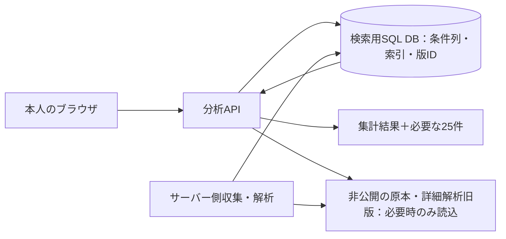

# DB構成の適合性評価：重賞から未勝利戦等への拡張

更新：2026-11-08（日本時間） / 対象コード：v0.5.2・`0ff7c31` / 状態：収集を停止したまま評価

## 1. 判定

**現行の「圧縮HTML原本と開催単位の大きな解析JSONを同じSQL DBへ保存し、JSON全体をPythonへ読み出す構成」は、未勝利戦等への拡張を含む最終構成として不採用とします。** 重賞の試作・環境外保護には役立っていますが、将来の容量・通信量・検索方法を満たす実証が不足していました。

**PostgreSQLというDB製品自体は今回の条件検索・集計に適しています。変更が必要なのは保存形式、検索処理、原本の置き場所、無料サービスの選び方です。** 型を持つ検索列と索引を使う試作では、50万出走で約203MB、100万出走で約411MB、集計処理は後述の内部検証で1秒未満でした。ただし、これは主テーブルと索引の試作であり、公開環境・出典索引・全旧版・バックアップを含めた完成検証ではありません。

今後は、**検索用SQL DBと、原本・詳細解析旧版を保持する非公開ファイル保存を分離**します。既存データは保持し、評価用のコピーだけを作成しました。元のDBや公開中の保管庫の構成は変更していません。

**収集は再開しません。** 保存先の容量・無料条件・検索性能・復元を確認してから収集再開の判定をします。このため、前の設計書にあった「まず初回収集を継続する」という順序を変更します。

## 2. 今回の評価範囲

ユーザーの追加指定は、初版は重賞を対象とし、最終的には未勝利戦なども対象に拡張することです。初版の収集範囲を即座に全競走へ変える指示とは扱わず、**DB設計と容量評価には全平地競走への拡張を織り込みます。** 機能1を完成確認してから機能2へ進む順序、Web利用、本人限定、無料のみという条件は維持します。

| 規模 | 評価での扱い |
| --- | --- |
| 現在の保存分 | 256開催・3,831出走。実測の基礎 |
| 初版の重賞 | 1,399開催の固定計画。出走件数の桁として約2万件を参考計算 |
| 未勝利戦等を含む10年規模 | 約50万出走を容量・検索試験の対象にする |
| さらに長期間の余裕 | 100万出走を試験。20年規模を考えるための負荷条件であり、20年の全件取得済みという意味ではない |

[JRA統計の公式公開HTML](https://japanracing.jp/_statistics/2025/s01.html)では、2016〜2025年の合計は**34,548競走・479,879延出走**です。これは障害を含む中央競馬全体であり、平地のみ・未勝利戦のみの確定件数とは異なります。将来の平地拡張を評価する規模の基準として使いました。競走結果の追加取得やPDF抽出はしていません。

## 3. 保存済みデータの実測

測定は11月8日10:09〜10:14 JST。収集ジョブは開始前・終了時とも`failed`、完了位置255/1,399でした。外部保管庫にも同じ256開催・3,831出走・原本4,543種類を確認しています。

| 内容 | 実測値 | 備考 |
| --- | ---: | --- |
| 作業用PostgreSQL全体 | 94,762,675 bytes | 約94.76MB |
| 圧縮HTML原本 | 62,751,753 bytes | 約62.75MB、4,543種類 |
| 原本テーブルの物理容量 | 70,049,792 bytes | 索引等を含む。DB全体の約74% |
| 最新256開催の解析JSON | 28,760,668 bytes | DBから読む本文量。PostgreSQL内部の圧縮前 |
| 最新解析JSONを個別gzipした量 | 4,041,318 bytes | 保存方式を変える場合の参考 |
| 旧版を含む解析276版の個別gzip | 4,235,011 bytes | 現時点の旧版込み。将来の訂正頻度は未確定 |
| 現D1スキーマによるローカルSQLite複製 | 103,837,696 bytes | 9テーブルをコピー。チェックポイント231行は未コピー。実D1の課金サイズではない |

PostgreSQLの物理容量とD1の物理容量は同じとは扱いません。SQLite複製は配備中D1のスキーマを使った容量比較であり、Cloudflare上の実割当量・キャッシュ・性能を測ったものではありません。[実測記録](research/storage/2026-11-08-feasibility/measurements.json)、[追加測定](research/storage/2026-11-08-feasibility/additional-measurements.json) に数値と対象を保存しています。

## 4. 全競走へ広げた場合の容量

下表は現在の3,831出走から件数に比例させた**参考拡大計算**です。将来データの実測値や統計的な予測区間ではありません。重賞馬と未勝利馬では走歴の長さが違い、同じ補助走歴の再利用も増えるため、原本の平均量が下がる可能性もあります。古い年度の形式、訂正回数等で増える場合もあります。この参考値だけから、D1に全競走が絶対に収まらないと証明した扱いにはしません。

| 保存・読込の内容 | 約2万出走 | 50万出走 | 100万出走 |
| --- | ---: | ---: | ---: |
| 現行PostgreSQL全体 | 0.49GB | **12.37GB** | **24.74GB** |
| 現D1スキーマのSQLite複製に基づく容量 | 0.54GB | **13.55GB** | **27.10GB** |
| HTML原本gzip | 0.33GB | 8.19GB | 16.38GB |
| 原本＋旧版込み解析gzip、1組 | 0.35GB | **8.74GB** | **17.49GB** |
| 上記を別途もう1組保持する場合の合計 | 0.70GB | **17.49GB** | **34.97GB** |
| 現行方式で広い対象を読む場合のJSON本文 | 0.15GB | **3.75GB/検索** | **7.51GB/検索** |

GBはこの表では10億bytesです。バックアップ1組分を追加する行は容量比較のための運用例であり、全原本を必ず二重に持つことを新たなユーザー要件として追加したものではありません。バックアップ方式・保持期間・共有上限は本番構成で確定します。

現在のアプリ側停止基準は圧縮原本350MB・新規原本追加時のPostgreSQL全体750MBです。初版重賞だけでも原本の参考値は約328MBであり、余裕が小さい状態です。閾値を大きくするだけでは、提供元の無料容量・将来分・復元先の問題は解決しません。

圧縮方法も確認しました。原本4,543件を16MiB単位のgzipパックにまとめ、全原本を元のSHA-256まで復元すると61,568,124 bytesでした。個別gzipの62,751,753 bytesから減ったのは**約1.9%**です。少なくとも今回試したまとめ方では、大容量問題を圧縮だけで解消できません。順番や圧縮方式の改善余地はありますが、未実証の大幅削減を容量計画へ算入しません。

正確な計算式・年度件数は [容量計算JSON](research/storage/2026-11-08-feasibility/capacity_projection.json) に保存しています。

## 5. 検索・アクセス時間の問題

### 5.1 現行コードで確認したこと

- [store.py](../src/keiba_web/store.py)の`dataset()`は、系列・期間で選んだ開催のJSON全文をSQLから読み、Pythonで展開します。14項目の絞込みはDBの索引では処理していません。
- [app.py](../src/keiba_web/app.py)の`run_query()`は明細全件、各項目の選択肢、不明件数をPythonで作り、APIへ全件を返します。画面の25件表示はブラウザ側のページ送りです。**DB・APIから25件だけを返す方式ではありません。**
- CSVも現状は全体をメモリに作ります。保存条件の解析版ID配列には500件の制限があり、数万開催をまたぐ保存条件にはそのまま使えません。
- 現APIは重賞の1系列を選ぶ仕様です。未勝利戦等を横断して検索する入口自体も未実装です。以下の広域読込は、その拡張時に現方式を残した場合の問題を調べる実験です。

保存済み3,831出走全体に条件を適用しJSONへ変換した処理は、中央値約299ms、5回中最大約315msでした。その実行中にPythonが新たに確保したメモリの追跡ピークは約27.85MBです。件数比例の参考値では50万件で約3.63GBに達します。これはDBや既存プロセスのメモリを含まないため、公開サーバーの必要メモリを保証する数字ではありません。

検索のたびに数GBのJSONをDBから送る構成では、処理時間に加えて無料枠の通信量も消費します。たとえばNeon Freeの月5GB転送に対し、上表の50万件の参考読込量は約3.75GBです。これを通常の条件変更ごとに行う設計は採用しません。

### 5.2 検索列・SQL集計・サーバー側ページ送りの試作

保存済みの条件値・払戻を型付きの列へ展開し、主キーと4本の索引を持つPostgreSQL表で比較しました。検索対象列、払戻状態、解析版ハッシュと出典参照を含みます。実データ3,831件では、一致/不一致/不明の件数、実出走数、勝数、単複の確認件数・払戻合計が既存Python計算と一致しました。比較した条件は枠1〜4と年齢3〜5のANDで、この組合せの条件不明は0件でした。全14条件・不明を含むすべての例外をSQLへ移植した完成版ではありません。

負荷試験では保存済みデータを繰り返し、ID・日付・競走クラスを模擬的に割り当てています。**50万件・100万件のJRA実データを追加収集したものではありません。**

| 測定項目 | 50万件：中央値 / 7回中最大 | 100万件：中央値 / 7回中最大 |
| --- | ---: | ---: |
| 表と索引の容量 | **203.49MB** | **410.53MB** |
| 全体の件数・条件判定・払戻等の集計 | **270 / 300ms** | **519 / 846ms** |
| 年代・クラス・枠・年齢による絞込み集計 | 3.4 / 4.2ms | 5.4 / 10.2ms |
| 条件に合う先頭25件 | 0.55 / 0.98ms | 0.57 / 1.16ms |
| 所属別の集計 | 102 / 118ms | 223 / 246ms |

試作の集計結果は数十〜百bytes、25件の明細は約2.1KBです。全明細JSONを返す必要はありません。ただし、この試作の表示列は9列であり、完成版の全項目・認証・選択肢生成・CSVを含むAPI応答量や時間ではありません。

測定条件は開発環境内PostgreSQL 17.11、共有バッファ128MB、work_mem 4MB、並列クエリなし、同一環境への接続です。環境のメモリ上限は8GiB、OSキャッシュを使用しています。表は検証用UNLOGGED、書込み・初回収集の速さは比較対象にしていません。7回の試験で統計的なp95を保証できないため、表では最大値を示しました。保存JSONの`p95_ms`はこの7標本では最大標本と同じです。

**これはDB側へ検索・集計を寄せる方式の適合性を示す検証であり、無料クラウド上の速度保証ではありません。** 地域間通信、プロキシ、サービス起動、同時処理、認証、画面表示は別に計測が必要です。

### 5.3 現在の環境外DBへのアクセス

既存の本人限定D1保管庫へ、認証付き`GET /api/status`を5回実行しました。初回約1,585ms、以後約170〜226ms、中央値約195msでした。DBへの書込・JRAへのアクセスはしていません。[測定記録](research/storage/2026-11-08-feasibility/remote-read.json) に保存しています。

これは現在の256開催の**件数照会**です。50万件の条件検索性能やブラウザ表示時間ではありません。また、現保管APIの件数照会は解析JSONや各表を走査するため、大量データで毎開催・毎画面表示に同じ処理を繰り返す方式も見直します。

## 6. 提供サービスの制限との照合

11月8日に公式資料を再確認しました。アカウントや課金設定は新規作成・変更していません。

| 提供サービス | 確認できた主な制限 | 今回の判定 |
| --- | --- | --- |
| 現在のSites/D1 | **1 SiteのDBは10GB**。2027年以降の枠・超過計量の案内があり、このアカウントの無料上限・課金停止は未確認 | 現データの保護は維持。現方式の50万件参考値13.55GBは上限超過の見込み。長期0円の最終保存先は未確定 |
| Cloudflare個人向けWorkers Free/D1 | **1 DB 500MB**、アカウント合計5GB、日500万行読取・10万行書込 | **Sitesの10GBと混同しない**。現行の丸ごと保存は不適合。検索用の小さい表でも索引・実読取行数の検証が必要 |
| Neon Free | **1プロジェクトのPostgreSQL 1GB**、別枠Object Storage 5GB、月5GB外向き転送、月100 CU時間 | 現行スキーマの原本込み保存は不採用。検索用表の試作は収まるが、付帯表・旧版・バックアップを含めた本番全体の採用判定は未完了 |
| Supabase Free | DB500MB、ファイル1GB、外向き5GB | 現行保存方式の容量不足を解消しない |
| Turso Free | SQL保存合計5GB、月5億行読取・1,000万行書込 | 型付きSQLの代替候補。PostgreSQLと同じ接続・SQLをそのまま使えるわけではなく、実環境の性能・無料設定・復元は未確認 |
| Cloudflare R2 Standard | 月10GB保存等の無料枠。超過は従量料金 | 無料枠だけで0円を保証しない。原本保存の確定先にはしない |
| Backblaze B2 | 最初の10GB保存は無料、課金上限機能あり | 原本の候補。無料アカウントでの上限動作、操作/転送、復元、増加分の余裕を未実証。1組約8.74GBの参考値でも余裕が小さい |

出典：[Sites Help](https://help.openai.com/en/articles/20001339-creating-and-using-chatgpt-sites)、[Sites料金案内](https://learn.chatgpt.com/docs/sites#pricing)、[D1上限](https://developers.cloudflare.com/d1/platform/limits/)・[料金](https://developers.cloudflare.com/d1/platform/pricing/)、[Neonプラン](https://neon.com/docs/introduction/plans)、[Supabase料金](https://supabase.com/pricing)、[Turso料金](https://turso.tech/pricing)・[使用量](https://docs.turso.tech/help/usage-and-billing)、[R2料金](https://developers.cloudflare.com/r2/pricing/)、[B2料金](https://www.backblaze.com/cloud-storage/pricing)・[課金上限](https://www.backblaze.com/docs/cloud-storage-data-caps-and-alerts)。個別値と確認時点は [提供元の制限JSON](research/storage/2026-11-08-feasibility/provider_limits.json) に保存しました。

D1を個人向けFreeで使う場合、50万行の全走査1回で約50万行の読取となり、日500万行なら単純計算で約10走査です。集計・選択肢・管理の複数走査があれば、さらに少なくなります。この上限をSitesへ流用はしませんが、「本人1名だから読取枠の評価は不要」とはしません。

Neonは公式に、Freeの転送・計算枠を使い切ると計算を休止し、容量上限では容量を増やす操作が失敗し、これらの制限だけではデータを削除しないと説明しています。それでも原本・検索DB・バックアップが実際に収まらなければ採用できません。複数の無料プロジェクトを作って容量を無理に合算することを解決策にはしません。

**比較した中に、現行方式のまま全競走・将来増分・バックアップ・長期0円をまとめて満たすと実証できた構成はありません。** これは無料での実現が一般に不可能だと証明したものではなく、現構成を採用確定して収集を進める根拠がないという判定です。

## 7. 修正する設計

### 検索用SQL DB

- 開催、馬、出走、条件値、払戻状態、出典参照、解析版を分離する。出走の条件値は型付きの列にし、`NULL`と確認状態を保持する。
- 主な検索軸となる開催日・競走クラス・競馬場・芝/ダート・距離を扱える構造にする。既存の14項目の定義を維持し、枠・年齢、騎手、種牡馬等には実際の検索に応じた索引を設ける。
- 多数の項目すべてに無条件で索引を付けず、実行計画・容量・更新コストを測定する。全期間の集計には全走査が必要な場合もあるため、解析版と条件をキーにした集計キャッシュも評価する。
- DBで条件判定・集計・件数計算し、APIはページ単位で明細を返す。深いページはキーによるページ送り、CSVは順次読出し/出力とする。

### 原本・解析版・出典

- 原本HTML、詳細な根拠、解析旧版、取得監査の詳細を圧縮ファイルで保持し、検索DBには参照IDと必要な索引だけを持つ。通常の検索で原本を読まない。
- 原本のSHA-256、URL、取得方法・時点、解析方式版を残す。原本や過去版を削除して容量不足を解決した扱いにはしない。
- 保存条件は巨大な解析版ID配列を画面へ渡す方式を改め、小さなデータ版IDから非公開の版一覧を参照する。訂正前の再現性を維持する。
- ファイル保存を応答確認・ハッシュ検証してから、SQLの参照を確定する。失敗時の再送、途中再開、孤立した保存物の検出、旧版の再現を試験する。
- 出典索引・馬等の辞書・解析旧版・保存条件・ジョブ・移行時の一時領域も容量計算に足す。主テーブルだけの203MBを「DB全体203MB」と説明しない。

### 配備・無料運用

既存コードを活用できるPostgreSQLを第一候補として維持しますが、**Neon等の1GBを本番全体が収まると確認せず採用しません。** 検索SQL・付帯表・原本/旧版・バックアップを含めた構成単位で選定します。別エンジンへ変える場合は、対応工数と集計結果の一致を含めて比較します。

Sitesの既存保管庫は、保存済みデータの保護先として維持します。本番の採用先・移行方式はまだ未確定です。今回、支払方法の登録、有料契約、別サービスのアカウント作成、既存データの削除・移行はしていません。

## 8. 追加収集を再開する前に行うこと

| 順序 | 確認する内容 | 現在の判定 |
| --- | --- | --- |
| 1 | 現構成の全競走への適合性を調べる | **最終構成として採用しない。容量の余裕・検索方式・無料枠の根拠不足を確認** |
| 2 | 型付きSQL・原本分離の実現性を試す | 検索の主要部分は50万/100万件で実証。原本圧縮も既存分で全ハッシュ復元。全規則・保存先統合は未完了 |
| 3 | 出典・旧版・保存条件等を含む全スキーマと移行・再現方式を試作する | 未完了。次の開発作業。保存済み原本だけを利用する |
| 4 | 保存先ごとの全体容量・年当たり増分・訂正/バックアップ保持・復元用領域を計算し、無料上限と照合 | 現方式は不足。新方式の本番全体を確定する必要あり |
| 5 | 採用候補の実サービスで、本人限定・無料超過時の停止・原本保管・復元を少量データで検証 | 未実施。技術調査だけで採用済みにしない |
| 6 | 実サービスで通常の検索・集計・25件表示を測る | 未実施。既存の約3秒目標をブラウザ表示まで測定し、起動直後と通常時を分ける |
| 7 | 容量・速度・費用・保全が成立した構成へ保存済みデータを移し、件数・SHA・集計・版の再現を照合する | 未実施。照合前に現在の保管庫を消さない |
| 8 | 以上を満たした構成で、既存初回ジョブの解析エラーを修正・検証し、未完了分から収集を再開する | **現在は再開しない** |

無料の容量・性能を実現するための調査・方式選定は開発側で進めます。本人情報や認証操作が不可欠になった場合は、先に目的・費用・依頼内容をまとめて説明します。ユーザーへDB製品の選定やコマンド実行を丸投げしません。

## 9. 再検証用の成果物

- [検証スクリプト](../tools/db_feasibility_probe.py)：既存PostgreSQLを読取専用で参照し、別の`keiba_capacity_*` DBに模擬表を作る。JRAへのHTTP取得機能は含まない。接続先はサーバー側環境変数で渡す。
- [実測値](research/storage/2026-11-08-feasibility/measurements.json)、[SQLite複製と解析gzip](research/storage/2026-11-08-feasibility/additional-measurements.json)、[環境外APIの時間](research/storage/2026-11-08-feasibility/remote-read.json)。
- [終了時の保存件数・停止状態の照合](research/storage/2026-11-08-feasibility/preservation-check.json)。
- [容量参考計算](research/storage/2026-11-08-feasibility/capacity_projection.json)、[提供元の制限と公式出典](research/storage/2026-11-08-feasibility/provider_limits.json)。
- [50万件の実行計画](research/storage/2026-11-08-feasibility/explain-500000.json)、[100万件の実行計画](research/storage/2026-11-08-feasibility/explain-1000000.json)。

実原本のコピー、SQLite/ベンチマークDB、認証情報は公開Gitへ追加しません。検証スクリプトのruff・書式確認と、SQL/Pythonの代表指標一致、既存原本4,543件のコピーからのハッシュ復元を確認しました。アプリ本体のコードは変更しておらず、直近の本体検証はv0.5.2の160テストです。
