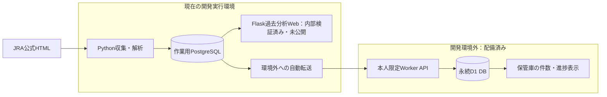
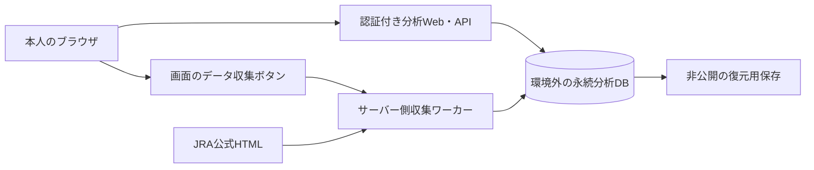

# 競馬データ分析システム 設計・進捗確認書

版：1.1 / 更新：2026-11-08（日本時間） / 確認対象の実装：v0.5.2・`0ff7c31`

本書は、ご本人が開発状況と今後の構成を確認するための設計書です。確定した要件、実装・検証済みの内容、稼働している部分、未完了の作業をまとめます。件数は**2026-11-08 00:43（日本時間）に取得した状態**で固定しています。以降の収集によって増える数値とは区別してください。[確認時点の状態JSON](review/system_state_20261108.json) を併せて保存しています。

**11/8のDB再評価：将来は未勝利戦等も対象にする。現行の原本・解析JSON一体保存は最終構成として不採用とし、検索用SQLと原本/旧版保存を分離する。容量・速度・無料条件・復元を実証するまで追加収集を再開しない。** [DB構成の適合性評価](database_feasibility.md) に実測値・公式制限・次の条件をまとめました。以下の保存件数は00:43の記録で、10:10の再確認でも同じです。

## 1. 現在の到達点

**過去分析の画面・検索・集計・収集ボタンは実装し、開発環境で検証しています。環境外の本人限定DBへの自動保存も稼働しています。ただし、過去分析Web本体の外部公開、全対象データの整備、本番用DBとの接続統合は未完了です。**

| 項目 | 現状 |
| --- | --- |
| 機能1：過去の条件別分析 | Web画面・API・DB保存を実装。代表データで内部検証済み。外部の利用URLは未提供 |
| JRAからの収集 | PythonによるHTTP取得・HTML解析・照合・DB保存を自動化。手作業での転記ではない |
| 環境外へのデータ保管 | 本人限定のSites/D1 DBを配備し、原本・解析結果・計画・再開位置の自動保存を実装。初回収集は下記エラーで停止中 |
| 初回データ整備 | 対象一覧は1,399開催。確認時点のDBには256開催・3,831出走を保存。255/1,399の位置で停止し、原因調査が必要 |
| 分析Webと環境外DBの統合 | **既存の分析WebはPostgreSQLを参照。D1から直接分析する接続は未実装** |
| 本番運用の実証 | 無料枠内の全体容量、公開先での取得・再起動・復元・速度確認が残る |
| 機能1のユーザー完成確認 | 未実施 |
| 機能2：今回の出走馬への適用 | 本体は未着手。機能1の完成確認後に実装する |

配備済みの [競馬データ保管庫](https://keiba-data-vault-20261107-b93d.relaxedbough1.chatgpt.site) は、保存件数・進捗を確認するための保管用コンポーネントです。過去分析画面の完成版URLではありません。

## 2. 作成するシステムと確定要件

### 2.1 別々に完成させる2機能

1. **過去分析**：過去のレース・期間・条件を指定して、該当馬の成績・単勝/複勝の実績回収率を検索・比較する。今回の出走馬や発売中オッズがなくても利用できる。
2. **今回への適用**：機能1の条件と分析結果を今回の出走馬へ適用し、単勝・複勝の期待値の目安と、その根拠を確認する。

**機能1を完成させ、ご本人が完成を確認してから機能2へ進みます。** 最終的には同じ条件・分析根拠を参照しながら両方を同時に使えるようにします。機能2を追加しても、機能1は単独で使える状態を維持します。

### 2.2 利用条件

| 項目 | 確定した方針 |
| --- | --- |
| 利用場所 | Web上。利用者はブラウザからアクセスし、PCへのプログラム・DB導入やコマンド実行は不要 |
| 利用者 | ご本人のみ。画面・API・収集操作を認証で保護する |
| 初版の対象 | JRA平地重賞全体、最低10年以上。2016〜2025年を初期10年とし、直近分も追加する |
| 対象の境界 | JRA主催の当時Jpn表記・京都開催の2018年JBCは含む。障害・地方主催・海外主催の重賞は初版の主集計対象外 |
| 将来の拡張 | 未勝利戦等を含む平地一般戦も対象にする。DB容量・検索方式を約50万〜100万出走でも評価する。初版の収集範囲を即時変更するものではない |
| 補助データ | 種牡馬・前走・脚質等の根拠として、対象重賞以外の走歴・一般戦結果も必要に応じて取得する |
| 取得元 | JRA公式の無料公開HTML。有料データ契約・PDF文字抽出・OCR・他社データによる穴埋めは使わない |
| 運用費 | Web・DB・原本・バックアップ・通信・実行処理を含めて無料。有料契約・カード登録・超過課金で補わない |
| 更新 | 画面の収集ボタンから新規・変更分を取得してDBへ保存する |
| 通常検索 | 保存済みDBを参照。検索・条件変更・再読込のたびにJRAから取り直さない |
| 初回準備 | 長期間の履歴整備は開発側の公開準備として行う。利用者に何時間も画面を開いておくことを求めない |

## 3. 進捗と検証結果

### 3.1 実装・稼働状況

| 分野 | 実装・検証したもの | 残っているもの |
| --- | --- | --- |
| 対象開催の特定 | 年度一覧を解析。133系列の改称・格付け・名称再利用を年別に識別 | 今後の未知の改称への追加対応、全対象の取得完了確認 |
| 取得・解析 | 結果、払戻、確定オッズ、血統、当時所属、直近3実出走の照合 | 全対象での項目充足・未知の公式表記の確認 |
| 過去分析 | 14項目、条件の組合せ、分類比較、成績・実績回収率、根拠明細 | 全件規模での正しさ・応答時間の確認 |
| Web操作 | 本人ログイン、収集・再開、条件保存、保存時点の再現、CSV | 外部公開した分析画面での一連の操作確認 |
| DB | 原本・出典・解析旧版・条件・ジョブを保存。環境外D1へ自動転送 | 分析Web本体の本番DB・実行基盤との統合 |
| 復元 | 外部D1から空DBへの全件読戻し、原本ハッシュ・解析内容・集計一致 | 全件規模での再試験、定期バックアップと保持期間の運用確定 |
| 公開 | 保管庫のWorker/API・D1を本人限定で配備 | 分析Web本体と収集ワーカーの運用先確定・配備 |

### 3.2 DBに保存されている量

以下は11月8日00:43の実測値です。原本には馬プロフィール・補助走歴なども含むため、原本数と開催数は一致しません。

| 項目 | 確認時点の値 | 意味 |
| --- | ---: | --- |
| 初回収集対象 | 1,399開催 | 2016〜2025年の1,291開催＋2026年の11月7日確認分108開催 |
| 対象年度 | 11年 | 2016〜2026年。2026年は途中まで |
| 環境外DBの最新開催 | 256開催 | 最新の解析版を持つ開催。全対象の整備完了ではない |
| 同DBの出走データ | 3,831件 | 最新開催版に含まれる馬の出走単位 |
| 同DBの解析スナップショット | 276版 | 訂正・再解析以前の版も含む |
| 同DBの原本本文 | 4,543種類 | SHA-256で同一本文を重複排除 |
| 同DBの取得記録 | 4,790件 | URL・取得方法・時刻と原本の対応 |
| 収集ジョブの完了位置 | 255 / 1,399 | このジョブで処理済みの開催。別途再利用した完成済み1開催があるためDBの256開催とは異なる |
| 作業用PostgreSQLの圧縮原本 | 62,751,753 bytes | 約62.75 MB。外部D1の物理使用量ではない |
| 作業用PostgreSQLのDB全体 | 94,762,675 bytes | 約94.76 MB。同じく開発側DBの測定値 |

**初回収集は11月8日00:33に255/1,399の位置で停止しています。** DBの状態は`failed`、説明は「一部のデータを確認できません。前の成功データを保持して停止しました。」です。計画上の次対象は2017-12-28のホープフルSです。外部DBにも同じ停止状態と保存件数を確認しました。詳細原因は未調査であり、保存原本と解析記録を確認してから修正・再開します。今回の文書作成で収集を再起動したり、失敗開催を無視したりしていません。

途中開催の原本は解析完了前にも保存します。**上記の件数だけで、全項目の品質確認済み・10年分収集済みとは判定しません。**

### 3.3 実施済みの検証

- v0.5.2までのPython自動テストは**160件合格**。ruff、書式、依存関係の整合性確認も合格。
- 代表10開催・159出走を用い、PostgreSQLと実ブラウザでログイン、集計、条件変更、保存時点の再現、CSV、再ログインを確認。画面幅390pxで横はみ出しがないことも確認。
- 取消、同着、複勝2着払い、降着、公式に明示された返還を実原本で検証。不明な払戻を0円と決めつけない。
- 外部DBに30開催・458出走・原本1,303種類・解析50版を保存した時点で、空DBへ全件復元。原本全件のSHA-256、解析本文、集計結果の一致を確認。
- 自動収集中の既知の降着注記による表記差をv0.5.2で修正。保存済み原本だけで再検証し、JRAへの追加要求0・エラー0を確認して収集を再開。

これらは内部検証・保存基盤の検証です。分析Web本体の公開環境での動作確認や、機能1のユーザー完成確認とは区別します。

## 4. 現在の構成と目指す構成

### 4.1 現在、実際につながっている構成

現在の収集プログラムの実行場所は開発環境内です。保存先のD1はその環境の外にあります。環境が失われた場合、そこで実行している収集処理は止まりますが、外部保存の応答確認まで完了したデータ・計画・再開位置は復元に利用できます。確認時点では前述のエラーで収集処理は停止しています。

**Flaskの分析処理とD1の間には、直接検索する接続をまだ実装していません。** 現在のSQLAlchemy実装はPostgreSQLを前提にしています。D1にはSQLite互換のSQL機能がありますが、PostgreSQLの接続先URLを置き換えるだけでは利用できません。

### 4.2 公開版で成立させる構成

これは完成時の役割構成です。公開先・分析DBの提供サービスは、無料条件と既存実装との適合を検証して確定します。通常検索は分析DBで完結し、収集ボタンを押した場合だけJRAへの取得を実行します。

## 5. DBの役割・所有・保存内容

### 5.1 誰のDBか

現在の環境外DBは、**この会話で利用しているChatGPTアカウント側のSitesプロジェクトにひもづく保管先**です。ネイティブの管理情報で、現在の利用者の権限がowner、許可アカウント1名、外部訪問者0名であることを確認しています。アシスタント個人のアカウントで所有するDBではありません。

基盤はSitesを通じて管理されるCloudflare D1です。ご本人が別途作成したCloudflareアカウントへ直接設置したDBとは異なり、利用継続はSitesの提供条件・アクセス権に依存します。保存データを認証付きで読み出し、別の空DBへ復元できることは実証しています。

| 保存先 | 用途と現在の位置づけ |
| --- | --- |
| 作業用PostgreSQL | 現在の収集処理・内部分析の接続先。開発環境内にあり、単独では恒久保管先にしない |
| 環境外D1 | 原本・解析版・計画・再開位置の永続保管先として稼働中。分析Web本体からの直接検索は未統合 |
| 非公開のSiteソースリポジトリ | 保管用Workerのソースと初回退避用DBダンプを保持。定期バックアップの運用完成を意味しない |
| 公開GitHubリポジトリ | システムのソース、設計書、検証結果を保存。原本全体、DBダンプ、秘密情報は追加しない |

現在のDB作成・保存にRender/Neonの新規登録は必要ありませんでした。Render・Neonのアカウントは未作成・未接続であり、採用済みの稼働サービスとして扱いません。

### 5.2 保存スキーマ

作業用DBのスキーマ版は1、通常の保存テーブルは9種類です。外部保管庫には保存確認用の`vault_checkpoints`を追加し、10種類を用意しています。

| テーブル | 主なキー・保存内容 | 目的 |
| --- | --- | --- |
| `keiba_settings` | 設定名、スキーマ版、原本容量等 | 設定管理。作業用DBでは本人パスワードのハッシュ・収集リースも扱う |
| `source_blobs` | 本文SHA-256、gzip原本、圧縮サイズ | 原本の保持・本文重複排除・破損検知 |
| `source_fetches` | 取得ID、URL、GET/POST、日時、本文SHA | 出典と取得時点の追跡 |
| `race_catalog` | 保存版URL、系列ID、開催日、一覧の抽出内容 | 対象開催の一覧 |
| `catalog_runs` | 年、確認範囲の末日、出典 | 未確認年度・期間を「開催0件」と誤認しないための管理 |
| `analysis_snapshots` | 解析版ID、開催ID、日付、JSON本文 | 出走馬・条件値・払戻・根拠を版ごとに保持 |
| `analysis_races` | 開催ID、系列ID、日付、最新解析版ID | 各開催の最新の保存版を選ぶ |
| `saved_searches` | 保存ID、名称、条件・対象解析版 | 保存時点の条件・結果を再現 |
| `acquisition_jobs` | ジョブID、対象計画、状態、完了位置、説明 | 失敗後の再開・重複処理防止 |
| `vault_checkpoints` | 保存確認時刻、各テーブルの件数 | 環境外への保存完了を確認する。外部保管庫のみ |

馬の出走・条件値は、現状では解析スナップショット内のJSONに保存しています。すべての条件を個別のリレーショナル表へ正規化した構成ではありません。現行の分析は、**SQLで系列・期間・解析版を絞り、Pythonで条件判定・集計**する方式です。全件規模で遅い場合は、既存の計算規則を維持して索引・検索方法を見直します。

### 5.3 保存の単位と再現性

- 開催は日付・競馬場・開催回日・レース番号、馬は公式馬IDで識別する。馬名だけで結合しない。
- 同一の原本本文はSHA-256で再利用する。本文が変わったときは旧原本を残す。
- 解析結果も版を保持し、最新ポインタを更新する。保存条件は利用した解析版を固定し、後日の訂正後も保存時点を再現できる。
- DB接続情報・サービス認証はサーバー側の秘密設定として扱う。ブラウザ・公開Git・設計書・ログへ実値を保存しない。

## 6. 使用プログラムと担当する処理

次のバージョンは確認時点の実行環境です。依存関係はロックファイルで固定しています。

| プログラム・技術 | 確認した版 | 役割・実装場所 |
| --- | --- | --- |
| Python | 3.12.14 | 収集、照合、分析、Webサーバーの共通言語 |
| requests | 2.32.5 | JRAへのHTTPS GET/POST。`src/keiba_acquisition/transport.py` |
| BeautifulSoup | 4.14.2 | 公式HTMLの表・リンク・フォームを解析。`src/keiba_acquisition/` |
| Flask / Jinja2 | 3.1.3 / 3.1.6 | 本人用画面、分析・収集・条件保存・CSVのAPI。`src/keiba_web/app.py`、`templates/` |
| Gunicorn | 26.2.0 | Python Webアプリの配信。内部ブラウザ検証に使用。公開先での稼働は未実施 |
| SQLAlchemy / psycopg | 2.1.8 / 3.3.8 | PostgreSQLへの保存・読込。`src/keiba_web/store.py` |
| PostgreSQL | 17.11 | 現在の作業用・内部分析用DB。公開版の外部PostgreSQLは未用意 |
| JavaScript・HTML・CSS | ブラウザ標準 | 条件入力、比較表、明細、ジョブ状態の表示。`src/keiba_web/static/` |
| Cloudflare Worker / D1 | Sites管理 | 環境外の保管APIと永続SQL DB。本人限定で配備済み |
| Node.js | 24.22.1 | 保管用Workerの開発・検証に使用。既存Python収集処理の実行基盤ではない |
| SQLite | 内部試験用 | 自動テスト・外部DBからの復元検証。利用者PCのDBとしては採用しない |
| Docker | 開発環境の機能 | PostgreSQLを用意する内部検証用途。利用者への導入要求はない |
| pytest / ruff | 8.4.2 / 0.14.4 | 自動テスト、静的検査、書式検査 |
| Git / GitHub | ソース管理 | 設計・コード・検証記録の履歴とレビュー用の保存 |

保管用Workerのソースは非公開のSiteソースリポジトリで管理し、配備情報は [保管庫の構成記録](research/storage/2026-11-07/project.json) に残しています。Python側の連携は本リポジトリの [vault.py](../src/keiba_web/vault.py) です。

`render.yaml`は候補設定であり、稼働中の公開環境ではありません。設定上のPython 3.12.12と現在の検証環境3.12.14には差があるため、採用時に版を揃えて検証します。

## 7. JRAからDBまでの具体的な自動処理

`Runner`がDBに固定した開催一覧を順に処理し、`Probe`が必要なページを決定し、`requests.Session`が通信します。公式ページを毎回人が開いてコピーする方法ではありません。

| 順序 | プログラムが行う通信・処理 |
| --- | --- |
| 1. 年度一覧 | `GET /datafile/seiseki/replay/YYYY/jyusyo.html`。名称・日付・開催場・距離・結果リンクを抽出し、系列対応表と照合 |
| 2. 保存版結果 | 一覧にある公式リンクをGET。開催日・競馬場・開催回日・レース番号を確定 |
| 3. 公式の過去結果検索 | HTMLのリンク・`doAction`から公開された`cname`値を抽出し、`POST /JRADB/accessS.html`へ送信 |
| 4. 対象年月 | 年月選択肢・`objParam`・認識済みの遷移テンプレートから対象年月を選び、同じ公式フォームへPOST |
| 5. 詳細結果 | 一覧から開催キーが一致する1件を選択。着順・馬ID・馬番・払戻等を解析 |
| 6. 確定オッズ | 結果内のオッズリンクからフォーム値を抽出し、`POST /JRADB/accessO.html`。馬番・馬IDを照合して結合 |
| 7. プロフィール等 | 公式馬プロフィールへGET。必要な場合は`accessC.html`へPOSTし、調教師の年付き所属歴も確認 |
| 8. 直近3実出走 | 対象日より前の公式走歴のリンクをたどり、詳細結果へPOST。開催キー・馬ID・着順を照合し、前走クラス・脚質の根拠を抽出 |
| 9. 保存と次開催 | 原本・解析版・最新ポインタを環境外DBへ保存し、保存確認後に完了位置を進める |

取得した原本は**解析より先に保存**します。解析で未知の形式に当たっても、保存した原本を使って原因調査・再解析できます。公式フォームの値を手で転記したり、未認識の値を推測して進めたりしません。

JRAへの要求は直列で、要求開始の間隔は最低2秒です。TLS検証を有効にし、403/429、照合不一致等では停止します。保存済みで対象時点に有効な原本はDBから再利用します。古いプロフィールが必要な開催日をカバーしない場合などに限り、該当原本を更新します。

保存処理は、作業用PostgreSQLへの書込に加えて`MirroredStore`が外部D1へHTTPSで転送します。外部保存の応答・件数確認に失敗した場合は、以降のJRA取得を止めます。再開前に未転送分を同期します。2つのDBをまたぐ単一トランザクションではなく、**再送できる保存処理と再開前同期で整合を回復する設計**です。

### 通常利用時の収集・検索

- **保存データで分析**：DBを読む。JRAへの通信は発生しない。
- **最新データを収集**：前年・当年の一覧を確認し、未保存開催と最近の保存済み結果・確定オッズを更新する。
- **過去データを収集**：指定した期間の不足分を補う。既存の成功データを毎回すべて再取得しない。
- **明示的な再取得**：古い結果の訂正等を確認する場合に使う。原本・解析旧版は残す。

「最近」の自動更新範囲は現実装では開催後14日以内です。これは実装上の初期値であり、すべての過去訂正を自動検知できるという意味ではありません。全件・差分更新の実測で妥当性を確認します。

## 8. 過去分析の仕様

### 条件と表示

対応済みの条件は、**枠順、脚質、騎手、種牡馬、性別、年齢、所属、前走クラス、前走距離、レース間隔、単勝人気、前走レース名、前走着順、単勝確定オッズ**の14項目です。従来の「性齢」を2項目に分けています。

異なる項目はAND、同じ項目の複数候補はORです。数値の範囲は上下限を含みます。判定は一致・不一致・不明の3種類とし、未取得・提供なしを不一致や0へ置き換えません。分類比較でも不明群を表示します。

表示するのは、対象件数、実出走数、勝率、連対率、3着以内率、単勝・複勝の的中率と実績回収率、分母、返還・不明件数、根拠明細です。明細は25件ずつ表示し、CSVは対象全件を出力します。条件保存は解析版も固定し、保存時点の再現と現在の保存データでの再分析を分けます。

### 計算とデータ品質

- 勝率等の分母は結果確定済みの実出走。中止・失格は含め、取消・除外は含めない。
- 回収率は券種ごとに確認できた有効購入を1頭100円として計算する。返還・未発売・払戻不明は区別する。
- 複勝の的中は実際の公式払戻で判定する。同着・少頭数を含むため、3着以内と同一にはしない。
- 対象0件は算出不能、対象ありで0勝なら勝率0%とする。表示率はDecimalで小数第1位に四捨五入する。
- 前走は対象日より前の直近の実出走。脚質は直近3実出走の通過順位から定義した方式で算出し、有効な根拠が2走未満なら不明。対象レース自身や未来の走歴は使わない。
- 所属は当該出走時の調教師所属を公式の年付き履歴で確認する。現在所属で過去を埋めない。確定できない移動年等は不明とする。
- 改称や同名レースの再利用は有効年度を持つ対応表で区別する。降着注記は原表記を保存して確定数値を照合する。

細かな算式・例外・時点の規則は [分析条件・データ品質仕様](analysis_rules.md) を正本とします。機能1の実績回収率と、機能2で扱う今回の期待値は別の指標です。

## 9. 認証・停止・復元・費用の扱い

### 認証

保管庫はSitesの本人限定アクセスで保護しています。匿名の状態API要求は401となることを確認しています。既存Flask本体には本人ログイン・一度限りの初期設定・パスワードハッシュ保存、CSRF/Origin検査、Secure/HttpOnly/SameSite Strict Cookieを実装しています。**この2種類の認証は別であり、公開版の入口・ログイン手順の統合確認は残っています。**

### 停止と再開

固定計画と完了位置をDBに保存し、途中の開催は保存原本を再利用して再試行します。同じ作業用DBでは120秒のリースで収集の重複起動を防ぎます。別々の復元環境をまたぐ分散排他は未実装のため、運用上も収集ワーカーは1つに限定します。

現在の実装は、アプリ起動や通常検索で収集を自動開始しません。利用開始後は明示的な収集・再開操作を入口とします。初回の大量取得は開発担当者が準備し、サーバー休止の承諾を繰り返し求めることを開発の停止条件にしません。

### 復元

外部保管庫から原本・解析・計画を空DBへ復元し、ハッシュ・件数・集計を照合してから未完了分を再開します。旧解析版や保存条件も保持する設計です。初回退避と復元試験は済んでいますが、定期バックアップ、保持期間、全対象規模での復元、公開環境での切替手順の実証は残っています。

### 無料運用

現在の保管庫作成・保存で、有料契約やカード登録は行っていません。一方、**全対象・補助走歴・バックアップが無料枠内に収まること、将来も同じ提供条件が続くことは未確認**です。Sitesの実容量・処理/通信枠・将来の料金条件も確認対象に含めます。

現行コードは圧縮原本350,000,000 bytesを停止基準にし、新規原本の追加時には作業用PostgreSQLのサイズ750,000,000 bytesも確認します。これはアプリ側の停止基準であり、D1や提供元の実際の無料上限を保証する値ではありません。全件完了までの容量・増分を実測し、提供元の制限も別に検証します。無料で成立しない場合は無料の代替構成を調べ、課金や旧データ削除で解決した扱いにはしません。

## 10. 今後の実装方針

### 10.1 分析Web本体のDB・配備先

**PostgreSQLを検索DBの第一候補として維持し、保存・検索方式を変更します。** 条件・成績を型付きの検索列へ分け、DBで集計して明細をページ単位で返します。原本・詳細解析旧版・取得監査の詳細は非公開のファイル保存へ分離します。全件JSONをPythonへ読み込む現方式を将来の最終構成には採用しません。

50万/100万出走の試作で検索表＋索引は約203/411MB、全体集計中央値は約270/519msでした。一方、現在の保存方式の件数比例による参考値は50万出走でDB約12.37GB、原本＋解析gzip約8.74GB/1組です。検索表だけが小さくなっても、原本・出典索引・旧版・バックアップを含む保存全体の検証が必要です。

Sitesの公式DB上限は10GB、Neon FreeのPostgreSQLは1GBです。これらの容量に全体が収まり、将来の増加と無料超過時の停止まで成立すると確認するまでは採用確定しません。D1やTurso等を使う案も、接続・SQL・移行・性能の対応が必要で、単なるURL差替えとは扱いません。詳細は [DB評価](database_feasibility.md) を参照してください。既存データは保管庫に保持し、現時点では移行していません。

方式選定・技術調査は開発側で進めます。本人情報・規約への本人同意・認証操作など、ご本人しか行えない作業が実際に必要になった場合だけ、目的、必要な理由、費用、準備済みの内容、依頼する具体的な操作をまとめて事前に説明します。認証情報をチャットへ貼ってもらう手順は使いません。

### 10.2 次の手順と完了条件

| 順序 | 行うこと | 完了を判断する内容 |
| --- | --- | --- |
| 1 | 収集を停止したまま、保存済みデータで全スキーマ・検索列・原本/旧版分離・版の再現を試作 | 全競走規模の容量・検索方式と既存集計の一致を評価できる |
| 2 | 提供元を選び、原本・付帯表・旧版・増分・バックアップを含む容量と無料条件を実証 | 上限内に収まり、超過課金せずデータを保持できる |
| 3 | 分析Webと新保存先を実環境へ統合し、検索速度・本人限定・再起動・空DB復元・移行を検証 | 約3秒の検索目標を実測し、既存データの件数・SHA・集計・旧版が再現できる |
| 4 | 上記成立後に255/1,399の解析エラーを修正・検証し、未完了分から初回収集を再開 | 初版の全対象の網羅率、条件の充足・欠損理由、原本と解析版を説明できる |
| 5 | 全データで通常の差分更新、画面・条件保存・CSV・中断再開を最終確認 | 検索はDBだけで完結し、容量・無料枠・速度・継続利用が実環境で成立する |
| 6 | 機能1を利用URL・対象範囲・操作例・検証結果とともに提示 | ご本人が過去分析を実際に確認し、必要な指摘を修正して完成を確認する |
| 7 | 完成確認後、機能2を実装 | 今回の出走馬・時点を記録したオッズへ同じ条件を適用し、根拠と期待値を表示 |
| 8 | 両機能を連携して最終確認 | 過去分析を単独でも使え、今回への適用と同じ条件・根拠を同時確認できる |

本書の確認は設計・進捗の確認です。機能1の完成確認を済ませたことにはしません。現時点で、現在の外部DB保存を継続するための新しいアカウント登録や、利用者PCでの準備は必要ありません。

## 11. 詳細資料・実装への参照

| 資料 | 内容 |
| --- | --- |
| [DB構成の適合性評価](database_feasibility.md) | 全競走への拡張、容量・性能の実測、サービス制限と収集再開前の条件 |
| [基本設計](basic_design.md) / [実装計画](implementation_plan.md) | 要件と工程の全体 |
| [分析規則](analysis_rules.md) | 条件・分母・払戻・脚質・情報時点 |
| [取得・保存手順](acquisition_pipeline.md) | HTTP通信から環境外DBまでの自動処理 |
| [Web構成](web_architecture.md) / [配備・運用](web_operations.md) | アプリ構成、秘密設定、停止・復元 |
| [Web内部検証](research/web/2026-11-07/report.md) | 代表データ・実ブラウザ・画面操作 |
| [環境外保存の検証](research/storage/2026-11-07/report.md) / [復元結果](research/storage/2026-11-07/restore-validation.json) | D1保存と空DBへの読戻し |
| [v0.5.2の実例検証](research/acquisition/2026-11-07-demotion/validation.json) | 降着表記差、保存原本での再検証、160テスト |
| [無料構成の調査](research/hosting/free-only-2026-11-07.md) | 候補サービスと残る検証事項 |
| [機能1の完成確認条件](history_acceptance.md) | 完成提示に必要なものとユーザー確認記録 |
| [作業進捗](progress.md) / [開発引き継ぎ](../HANDOFF.md) | 開発履歴と再開時の注意 |

履歴資料の件数・テスト数は各実施時点の値です。現状の概要は本書、変動する保存件数は確認日時付きの状態記録、計算規則は分析規則を参照してください。
